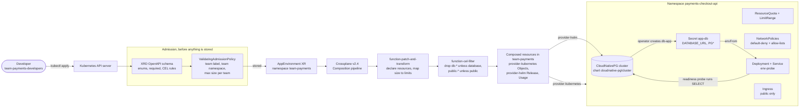

# crossplane-self-service

[](https://github.com/ahmedelgmal310/crossplane-self-service/actions/workflows/ci.yml)
[](LICENSE)

A self-service **internal developer platform** on **Crossplane v2**. A developer asks for a
complete environment with one small YAML claim. The platform then builds it: a namespace with
a quota and default-deny network policy, a **PostgreSQL** database (CloudNativePG, installed
through **provider-helm**), a credentials Secret delivered to the app, the app's Deployment and
Service, and an Ingress when the claim asks for one.

Every push to `main` re-proves this on a throwaway **kind** cluster. CI applies real claims as a
developer, times each one to `Ready=True`, connects the app to its database with the delivered
Secret, resizes an environment, breaks things by hand and times the repair, then deletes
everything and checks that nothing is left behind. If any step does not happen, the job fails.

## Contents

- [The problem](#the-problem)
- [The developer experience](#the-developer-experience)
- [How it works](#how-it-works)
- [Policy: what a claim may ask for](#policy-what-a-claim-may-ask-for)
- [Results from CI](#results-from-ci)
- [Testing the Compositions](#testing-the-compositions)
- [The AWS Composition (render-only)](#the-aws-composition-render-only)
- [Design decisions](#design-decisions)
- [Limitations](#limitations)
- [Runbook](#runbook)
- [Repository layout](#repository-layout)

## The problem

Without a platform, a team that needs a new service environment opens a ticket. Someone on the
platform team creates the namespace, guesses a quota, forgets the network policy, provisions a
database, pastes the password into a Secret, and writes the Deployment. Every environment ends
up slightly different, the slow part is waiting for a person, and nobody can say which objects
belong to which environment when it is time to delete it.

This project turns that ticket into an API. The team writes about ten lines of YAML. The
platform decides everything else from policy: which quota a size means, which network paths
are open, how credentials get to the app, and what gets deleted when the claim goes away.

## The developer experience

A developer on the payments team asks for a medium environment with a database, exposed through
an Ingress:

```yaml
apiVersion: platform.example.io/v1alpha1
kind: AppEnvironment
metadata:
  name: checkout-api
  namespace: team-payments
  labels:
    platform.example.io/team: payments
spec:
  size: medium
  database: true
  exposure: public
  hostname: checkout.payments.apps.example.test
  image: "env-probe:e2e"
  port: 8080
```

```console
$ kubectl apply -f checkout-api.yaml
appenvironment.platform.example.io/checkout-api created

$ kubectl get appenvironments -n team-payments -o wide     # from the CI run linked below
NAME           SIZE     DATABASE   EXPOSURE   NAMESPACE               SYNCED   READY   COMPOSITION           COMPOSITIONREVISION           AGE
checkout-api   medium   true       public     payments-checkout-api   True     True    appenvironment-kind   appenvironment-kind-a493203   32s
preview        small    false      internal   payments-preview        True     True    appenvironment-kind   appenvironment-kind-a493203   32s
```

The app reads `DATABASE_URL` (and the libpq `PG*` variables) from the Secret `app-db` in its own
namespace. The developer never sees the password, never creates a namespace, and has no RBAC
rights on quotas, network policies or databases: the only thing they can create is an
`AppEnvironment` in their team namespace (CI checks this with `kubectl auth can-i`).

Claims can also be scaffolded with the small `platformctl` CLI, which checks names, enums and
the hostname rule before anything reaches the cluster:

```console
$ go run ./cmd/platformctl new --name preview --team payments --size small --image env-probe:e2e
apiVersion: platform.example.io/v1alpha1
kind: AppEnvironment
metadata:
  name: preview
  namespace: team-payments
  labels:
    platform.example.io/team: payments
spec:
  size: small
  database: false
  exposure: internal
  image: "env-probe:e2e"
  port: 8080
```

CI uses `platformctl` to create the small environment, so its output is tested against the real
API on every run.

| Field | Values | Effect |
|---|---|---|
| `metadata.labels[platform.example.io/team]` | a registered team | required; must match the team namespace; decides the maximum size |
| `spec.size` | `small`, `medium` | quota, app replicas, database storage and resources |
| `spec.database` | `false` (default), `true` | CloudNativePG cluster + `app-db` Secret + DB network policies; immutable |
| `spec.exposure` | `internal` (default), `public` | `public` adds an Ingress and opens the app to the ingress controller namespace |
| `spec.hostname` | DNS name | Ingress host; required when `exposure: public` |
| `spec.image`, `spec.port` | image, 1024-65535 (default 8080) | the application container |

What a size means:

| | small | medium |
|---|---|---|
| ResourceQuota requests (CPU / memory) | 1 / 1Gi | 2 / 4Gi |
| ResourceQuota limits (CPU / memory) | 2 / 2Gi | 4 / 8Gi |
| Pods / Services / PVCs / storage | 10 / 5 / 2 / 2Gi | 20 / 10 / 4 / 10Gi |
| App replicas | 1 | 2 |
| PostgreSQL storage / limits | 1Gi / 500m, 512Mi | 5Gi / 1 CPU, 1Gi |

## How it works



**The API** ([`apis/appenvironment/definition.yaml`](apis/appenvironment/definition.yaml)) is a
Crossplane v2 `CompositeResourceDefinition` with `scope: Namespaced`. In Crossplane v2 a
namespaced composite resource replaces the old claim + cluster-scoped XR pair, so the object a
developer creates *is* the composite resource. I still call it a claim, because that is what it
is from the developer's side.

**The Composition** ([`apis/appenvironment/composition-kind.yaml`](apis/appenvironment/composition-kind.yaml))
is a two-step function pipeline:

1. **function-patch-and-transform** declares up to 15 resources and patches them from the claim.
   Sizes become quotas, replicas and database resources through `map` transforms, and the
   namespace name is `<team>-<name>`. Every composed resource gets a stable name, such as
   `checkout-api-namespace`, so the deletion order below can refer to it.
2. **function-cel-filter** drops resources whose names start with `db-` unless
   `spec.database` is true, and those starting with `public-` unless `spec.exposure` is
   `public`.

What gets composed (counted in CI):

| Resource | Kind | small, no DB | medium, DB, public |
|---|---|:-:|:-:|
| Namespace (team, size and Pod Security labels) | Object | yes | yes |
| ResourceQuota `env-quota`, LimitRange `env-defaults` | Object x2 | yes | yes |
| NetworkPolicy `default-deny` (ingress + egress), `allow-dns`, `allow-same-team` | Object x3 | yes | yes |
| Deployment `app`, Service `app` | Object x2 | yes | yes |
| Ingress `app`, NetworkPolicy `allow-ingress-controller` | Object x2 | | yes |
| CloudNativePG cluster `db` (Helm chart `cloudnative-pg/cluster` 0.9.0) | Release | | yes |
| Secret `app-db`: `DATABASE_URL`, `PGHOST`, `PGPORT`, `PGDATABASE`, `PGUSER`, `PGPASSWORD` | Object | | yes |
| NetworkPolicies `allow-app-to-db`, `allow-db` | Object x2 | | yes |
| Usage: the namespace cannot be deleted before the Helm release | Usage | | yes |
| **Total** | | **8** | **15** |

**Credentials.** CloudNativePG creates the database user and its password inside the cluster and
writes them to the Secret `db-app`. A provider-kubernetes `Object` with `references.patchesFrom`
copies the six fields into the platform's own contract, the Secret `app-db`. The app only knows
that contract, so the database backend can change without touching the app. No password exists
in Git, in the claim, or in the Composition. With a database, the Deployment's `envFrom` is
`optional: false`, so pods wait for the Secret instead of starting without `DATABASE_URL`.

**Readiness means it works.** The Deployment Object is Ready only when every replica is ready,
using a CEL readiness query on the live Deployment. The app's readiness probe runs a query
against PostgreSQL. So when a claim with a database reports `Ready=True`, the app has already
reached its database with the delivered credentials.

**Drift.** All Objects use `watch: true`, so provider-kubernetes watches the objects it manages
and re-applies the desired state when someone changes or deletes them. It does not wait for the
10-minute poll. Crossplane recreates composed resources that are deleted outright.

**Garbage collection.** Deleting the claim deletes every composed resource. The `Usage` makes
Crossplane's admission webhook refuse to delete the namespace Object while the Helm release still
exists. Helm therefore uninstalls the database cleanly first, and then the namespace and
everything in it go. With `replayDeletion: true`, the namespace deletion is retried as soon as
the release is gone.

**The workload** ([`cmd/env-probe`](cmd/env-probe), [`internal/probe`](internal/probe)) is a
small Go service that stands in for a team's app. `/readyz` checks the database when one is
configured, `/db` reports the session (user, database, server version, latency), and
`POST /db/write` inserts and counts rows to prove the credentials can write. It runs as a
non-root user on distroless with a read-only root filesystem and all capabilities dropped.

## Policy: what a claim may ask for

Rules are enforced by the API server at admission time. Nothing is stored, so nothing is
composed, for an invalid claim.

| Rule | Where | Mechanism |
|---|---|---|
| `size` is `small` or `medium`; `exposure` is `internal` or `public`; `image` required | XRD schema | OpenAPI enum / required |
| `hostname` required when `exposure: public` | XRD schema | CEL `x-kubernetes-validations` |
| `database` cannot be changed after creation (no accidental data loss) | XRD schema | CEL transition rule |
| claim carries the `platform.example.io/team` label | [`platform/policy/team-policy.yaml`](platform/policy/team-policy.yaml) | ValidatingAdmissionPolicy |
| team is registered with the platform | same | VAP + ConfigMap `platform-system/team-limits` as parameters |
| team label matches the team that owns the namespace (no billing to another team) | same | VAP `namespaceObject` |
| size does not exceed the team's maximum (`payments: medium`, `growth: small`) | same | VAP, also checked on update so a resize cannot bypass it |
| team label is immutable; `<team>-<name>` fits in a namespace name | same | VAP |

The per-team limits are data, not code: adding a team or raising a limit is a one-line change
to a ConfigMap. The policy skips Crossplane's own service account and objects that are being
deleted, so a claim that becomes invalid later (for example, a team's limit is lowered) can
still be reconciled and deleted.

Why a ValidatingAdmissionPolicy and not only XRD CEL: CRD validation rules cannot see labels,
the namespace, or external data. VAP is built into Kubernetes, uses the same CEL, and needs no
webhook deployment to keep alive.

## Results from CI

Numbers below are from **[CI run 40731320556](https://github.com/ahmedelgmal310/crossplane-self-service/actions/runs/40731320556)**
(all five jobs green, commit `dc6e20e`), on a GitHub-hosted `ubuntu-24.04` runner with kind v0.33.0 and
Kubernetes v1.36.4. Each value is written by `record` in [`e2e/run.sh`](e2e/run.sh) and published in
the job summary and the `e2e-results` artifact (`results.json`, `summary.md`, `timeline.md`,
`deletion-*.log`). The whole e2e job, including cluster creation and image build, took 4 min 24 s.

| What was measured | Result |
|---|---|
| Platform install on an empty cluster (Crossplane, CNPG operator, 2 providers, 2 functions, API, policy) | **41.6 s** |
| Invalid claims rejected at admission, none persisted | **5 / 5** |
| Claim to `Ready=True`: **small**, internal, no database (8 composed resources) | **12.2 s** |
| Claim to `Ready=True`: **medium**, public, PostgreSQL (15 composed resources, includes chart install, initdb and the app's DB readiness query) | **31.0 s** |
| App connects with `DATABASE_URL` from the delivered Secret | connected as `app` to `app`, PostgreSQL 18.6, query **0.29 ms**; two writes, row count 1 then 2 |
| Network policy probes (`pg_isready` to the database) | **3 / 3**: app pod accepted, other pod in the namespace blocked, pod in another namespace blocked |
| Resize `small` to `medium`: quota updated, second replica ready, `Ready` for the new generation | **0.9 s** |
| Drift: `kubectl delete` of the `default-deny` NetworkPolicy until a new one (new UID) exists | **0.1 s** |
| Drift: quota raised by hand to `pods: 999` (accepted by the API) until reverted to 20 | **0.2 s** |
| Drift: delete the composed Deployment Object (the provider deletes the Deployment) until a new Deployment is 2/2 ready | **4.3 s** |
| Delete the medium claim until the XR, namespace, MRs, Usage, CNPG cluster, PVs and labelled objects are all gone | **13.7 s** |
| Delete the small claim, same checks | **22.9 s** |
| Managed resources left in the cluster after both deletions | **0** |
| Go test coverage (race detector on, PostgreSQL integration test included) | **89.2 %** (gate 80 %) |

The drift times are short because every Object uses `watch: true`. The provider sees the change
as a watch event and does not wait for its 10-minute poll. The poll loop that measures them checks
about every 0.1 to 0.5 s, so read "0.1 s" as "repaired before the first check came back". Each
drift case first proves the change really happened: a new UID, or the API returning the tampered
value.

Where the time goes for the medium claim (seconds after the claim was created, API timestamps):

| Composed resource | Ready at |
|---|---|
| Helm Release (CNPG `cluster` chart installed), quota, limit range, `allow-dns`, `allow-app-to-db`, `allow-ingress-controller` | 2 s |
| Namespace, `app-db` Secret (copied as soon as CNPG writes `db-app`) | 3 s |
| `default-deny`, `allow-same-team`, `allow-db`, Service, Ingress | 4 s |
| Deployment (both replicas ready, which needs PostgreSQL initialised and the readiness query passing) | 31 s |

So almost all of the 31 s is PostgreSQL starting: pulling the image, `initdb`, and the first
instance becoming primary. The platform's own work is done in about 4 s. On deletion the
Kubernetes objects are gone first (namespace after 7 s for the small claim); the rest is
provider-kubernetes confirming that its managed resources are deleted.

### A finding: the XR watch circuit breaker

The first green runs had odd numbers. The small claim took 66 s to become Ready even though its
slowest composed resource was Ready after 11 s, and the medium claim took 58 to 66 s although,
in the run that recorded a timeline, everything it composed was Ready at 29 s. The XR's conditions explained it
([run 40725813823](https://github.com/ahmedelgmal310/crossplane-self-service/actions/runs/40725813823),
`xr-conditions.json`):

```json
{ "type": "Responsive", "status": "False", "reason": "WatchCircuitOpen",
  "message": "Too many watch events from Object/checkout-api-netpol-db (team-payments). Allowing events periodically." }
```

With realtime compositions, Crossplane v2 passes every watch event from a composed resource
through a per-XR token bucket, by default a burst of 100 and a refill of 1 per second. Creating
15 provider-kubernetes Objects with `watch: true` produces more than 100 events in the first
seconds, because each Object's status mirrors its live object. The breaker opens, and the XR
only notices that its resources are ready on a 30 s half-open probe or its own requeue backoff.
The breaker is meant to stop hot loops, not a normal create burst. Raising it to a burst of 500
and a refill of 10/s (`CROSSPLANE_ARGS` in [`e2e/lib.sh`](e2e/lib.sh)) keeps that protection and
fixed it:

| | Default breaker (3 runs) | Tuned breaker (2 runs) |
|---|---|---|
| `Responsive` after provisioning | `False` (WatchCircuitOpen) on the medium claim | `True` on both |
| Medium claim to Ready | 66.5 s, 57.7 s, 58.1 s | 27.8 s, 31.0 s |
| Small claim to Ready | 65.9 s, 66.2 s, 5.2 s | 12.5 s, 12.2 s |
| Resize to Ready | 41.5 s, 38.8 s, 0.7 s (the run where the small claim's breaker stayed closed) | 0.9 s, 0.9 s (the second with the stricter new-generation check) |

I also tried making each in-namespace Object `dependsOn` the namespace, so that it would be
applied the moment the namespace appeared. It did not help: the provider starts watching a
reference only after it has resolved once, and it put finalizers on the environment namespace
(one deletion then took 126 s). I reverted it. The remaining spread in the small claim (5 to
12 s) is the provider's retry backoff for objects created a moment before their namespace
existed.

### Rejected claims (verbatim API server responses from the same run)

| Claim | Rejected by | Message |
|---|---|---|
| [`missing-team-label.yaml`](examples/invalid/missing-team-label.yaml) | ValidatingAdmissionPolicy | `AppEnvironment must carry the label platform.example.io/team` |
| [`growth-medium.yaml`](examples/invalid/growth-medium.yaml) | ValidatingAdmissionPolicy | `team growth may request at most size small, got medium` |
| [`wrong-team-namespace.yaml`](examples/invalid/wrong-team-namespace.yaml) | ValidatingAdmissionPolicy | `label platform.example.io/team=growth does not match the team that owns namespace team-payments` |
| [`unknown-size.yaml`](examples/invalid/unknown-size.yaml) | XRD OpenAPI schema | `spec.size: Unsupported value: "xlarge": supported values: "small", "medium"` |
| [`public-without-hostname.yaml`](examples/invalid/public-without-hostname.yaml) | XRD CEL rule | `spec.hostname is required when spec.exposure is public` |

Updates are checked too. Setting `spec.database: false` on the database claim is refused with
`spec.database is immutable`, and relabelling a claim to another team is refused by the policy.

## Testing the Compositions

Compositions are code, so they have unit tests that do not need a cluster:

- **Golden files.** [`scripts/render-test.sh`](scripts/render-test.sh) runs
  `crossplane composition render` for each case in [`test/render/`](test/render) with the real
  functions and the Crossplane v2.4.3 render engine (pinned by digest), and diffs the output
  against the committed `expected.yaml`. A change to a Composition that changes what gets built
  shows up as a reviewable diff. Run `UPDATE_GOLDEN=1 scripts/render-test.sh` to accept it.
  The five cases cover small/internal (8 resources), small/internal with a database (13),
  medium/public with a database (15), and both AWS variants.
- **Schema validation.** `crossplane resource validate` checks every rendered resource against
  the CRDs inside the provider-kubernetes, provider-helm and AWS provider packages and the XRD.
  It also checks the function inputs against the function packages and evaluates the XRD's CEL
  rules against the example claims. Two invalid examples must fail it offline.
- **kubeconform.** The Kubernetes manifests embedded in every rendered `Object` (Namespace,
  ResourceQuota, NetworkPolicy, Deployment, Ingress and so on) are extracted and checked with
  `kubeconform -strict`, together with the team and policy manifests.
- **Go.** `go test -race` with an 80% coverage gate, including an integration test against a
  real PostgreSQL service container, golangci-lint (with gosec) and govulncheck.

Plus Gitleaks over the full history, shellcheck, actionlint, hadolint and yamllint.

## The AWS Composition (render-only)

[`apis/appenvironment/composition-aws.yaml`](apis/appenvironment/composition-aws.yaml) shows
that the same `AppEnvironment` API can be backed by a cloud. It maps the claim to Amazon RDS for
PostgreSQL (instance class, storage and Multi-AZ from `size`; encrypted; private; an auto-created
master password in a Secret; final snapshot on delete) and an S3 bucket with public access
blocked and KMS encryption by default.

**It is never applied.** Nothing in this repository creates AWS resources and there are no AWS
credentials anywhere. CI only renders it and validates the output against the
`crossplane-contrib/provider-aws-rds` and `provider-aws-s3` v2.8.1 schemas. A claim would select
it with `spec.crossplane.compositionSelector.matchLabels: {platform.example.io/provider: aws}`.
The in-cluster half (namespace, quota, network policy, Deployment) is left out of it to keep the
cloud mapping readable; in a real installation it would reuse the same Objects pointed at an EKS
ProviderConfig.

## Design decisions

**Why function-patch-and-transform plus function-cel-filter, and not a Go or KCL function.**
The logic here is mapping (size to limits) and inclusion (database, public), and both fit
declarative patches. P&T is the most widely known composition style, so any platform engineer
can review it as YAML, and the golden files make every change visible. A custom Go function
would add an image to build, sign and ship, and a second language to review, for no capability
this API needs. I would switch to a Go function, or function-go-templating, when the
Composition needs loops, lookups across resources, or logic that patches cannot express clearly.

**Why CloudNativePG through provider-helm, and not a raw StatefulSet.** CloudNativePG creates
the credentials (so no secret is ever written by the platform), handles initdb and failover, and
ships a maintained `cluster` chart. Installing that chart per environment through provider-helm
uses Crossplane the way it is used with real third-party software: Crossplane manages the
release and its values, and the operator manages the database.

**Why provider-kubernetes Objects, and not composing Kubernetes objects directly.** Crossplane v2
can compose arbitrary resources, but a namespaced XR may only compose into its own namespace.
The environment lives in a new namespace, so the composed resources are namespaced Objects in
the team namespace that manage objects elsewhere. They also give per-object readiness (CEL
queries), watches for drift, and `patchesFrom` for the Secret contract.

**Why a replica-ready readiness check.** "Created" is not "working". Readiness requires the
Deployment to have all replicas ready and updated, so the time to `Ready=True` in the results
is the time until the app actually serves traffic and, with a database, has queried it.

## Limitations

- **One cluster.** Environments are built on the cluster that runs Crossplane. A real platform
  would usually target workload clusters through per-cluster ProviderConfigs.
- **Providers run as cluster-admin.** provider-kubernetes and provider-helm can create anything.
  That is acceptable on a throwaway CI cluster; in production, bind a ClusterRole scoped to the
  kinds the Composition emits.
- **No ingress controller in CI.** The Ingress and the ingress-controller network policy are
  created and checked, but no traffic goes through an ingress in the test (ingress-nginx is
  retired and I did not want the result to depend on a controller choice). The app is reached
  with `kubectl port-forward`.
- **Network policy egress to the API server is port-based.** The database pods need the
  Kubernetes API, and the address is not known to the Composition, so `allow-db` allows egress
  on TCP 443/6443 to any destination. A CNI with FQDN or service-based egress rules (Cilium,
  for example) could narrow that.
- **Single-instance databases, no backups.** One PostgreSQL instance per environment on
  kind's local-path storage, which does not enforce size or support volume expansion. A resize
  changes quota and replicas; it does not grow an existing database volume. Backups (CNPG
  barman-cloud plugin to object storage) are out of scope.
- **`database` is immutable on purpose.** Turning it off would delete the database. A team
  that wants that has to delete the environment.
- **Timings are from GitHub-hosted runners.** They include image pulls on a cold kind
  cluster and vary from run to run. Treat them as orders of magnitude, not SLOs.
- **The AWS Composition is unproven against AWS.** It is schema-valid against the provider
  CRDs, which catches wrong fields and types, but it has never created a real RDS instance.

## Runbook

Prerequisites: Docker, kind, kubectl, Helm 4, Go 1.27, and optionally the crossplane CLI.

```sh
# Platform on a local kind cluster
kind create cluster --name platform --image kindest/node:v1.36.4
docker build -t env-probe:e2e . && kind load docker-image env-probe:e2e --name platform
e2e/setup.sh

# Request an environment as a payments developer
kubectl apply --as=alice --as-group=team-payments-developers -f examples/checkout-api.yaml
kubectl get appenvironment -n team-payments -w

# Full CI scenario (needs bin/platformctl)
go build -o bin/platformctl ./cmd/platformctl && e2e/run.sh

# Composition unit tests (Docker needed for the functions)
scripts/render-test.sh
UPDATE_GOLDEN=1 scripts/render-test.sh   # accept an intended change
```

Operating it:

| Symptom | Look at | Typical cause |
|---|---|---|
| `kubectl apply` is rejected | the error message names the rule | claim breaks a schema rule or the team policy (see [Policy](#policy-what-a-claim-may-ask-for)) |
| Claim `SYNCED=False` | `kubectl describe appenvironment <name> -n <team-ns>` | a function or patch failed; render the claim locally with `scripts/render-test.sh` |
| Claim `READY=False` for long | `kubectl get objects,releases -n <team-ns> -l crossplane.io/composite=<name>` | the unready resource is named in the `Ready` condition message |
| Deployment Object not ready, DB claim | `kubectl get pods -n <team>-<name>`; `kubectl logs deploy/app` | pod waits for Secret `app-db` (database not up yet) or fails the DB readiness query |
| Release not ready | `kubectl describe release <name>-db -n <team-ns>` | chart repository unreachable or values rejected by the chart schema |
| Deletion hangs | `kubectl get usages -n <team-ns>` | the Usage holds the namespace until the Helm release is gone; check the Release's events |
| A team needs a bigger size | edit `platform/policy/team-policy.yaml` (`team-limits`) | sizes above a team's limit are refused by design |

Adding a size: add the key to the XRD enum, to every `map` transform in both Compositions and to
the `rank` variable in the admission policy. Then run `UPDATE_GOLDEN=1 scripts/render-test.sh`
and review the diff.

## Repository layout

```
apis/appenvironment/   XRD, kind Composition, render-only AWS Composition
platform/              providers, functions, provider configs, teams + RBAC, admission policy
examples/              valid claims and five invalid ones (each must be rejected)
cmd/env-probe/         workload that proves the database connection
cmd/platformctl/       CLI that scaffolds claims
internal/              probe server, PostgreSQL client, claim rendering
test/render/           render cases with golden expected.yaml
test/schemas/          provider packages used by crossplane resource validate
scripts/render-test.sh golden-file runner
e2e/                   kind setup and the end-to-end scenario
docs/versions.md       every pinned version and its release date
```
